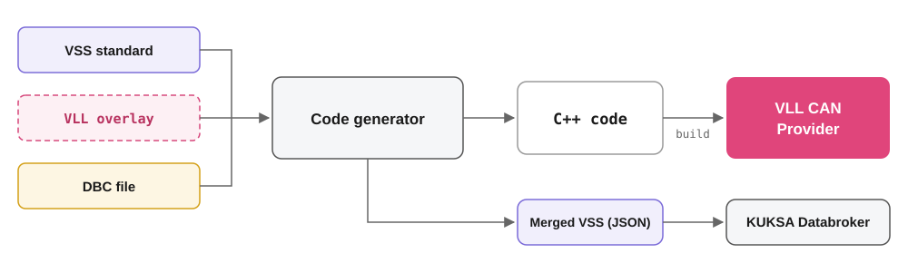
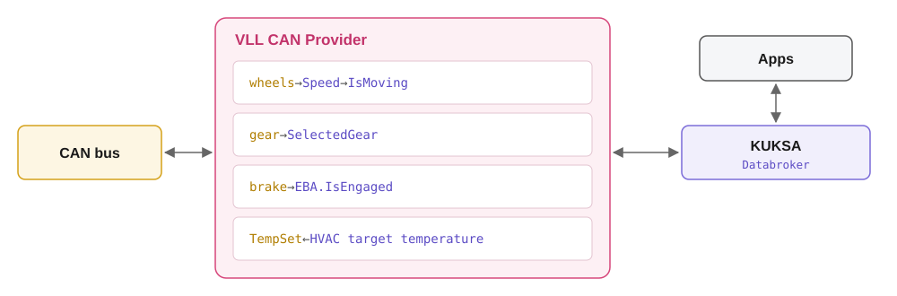

# VLL Concept

> The VLL syntax and features are described in [features.md](features.md). Korean: [ko/concept.md](ko/concept.md)

This document describes VLL (VSS Logic Language), a language for defining mapping rules between vehicle-specific CAN signals and standard VSS signals in a VSS overlay, and the VLL CAN Provider that is built from those rules.

## 1. Background: why VLL

### 1.1 VSS defines WHAT, not HOW

With VSS, apps read vehicle data by standard names such as `Vehicle.Speed`, regardless of the vehicle model. The standard names a signal; it does not say how the signal is made. That is the job of a provider. A provider is a program that reads vehicle signals and passes VSS values to the KUKSA Databroker.

| VSS defines WHAT | VSS leaves open HOW |
|---|---|
| Name, type, unit, meaning | From which CAN signals? With which formula? |

The mapping depends on the vehicle model and the project, and each provider usually implements its own. As a result, the same mapping is implemented again in many places and never shared. Standard VSS is a shared definition used by many apps and providers, so model-specific mappings cannot go into the standard files either. Instead, VSS supports overlay files that add nodes or attributes on top of the standard: the standard stays untouched, and the mapping lives on the overlay.

### 1.2 In real vehicles, not every signal maps one-to-one

In a real vehicle, one VSS signal may need several CAN signals combined, another VSS signal as input, or a different calculation depending on a condition. The following cases come from openDBC, a public dataset.

| Case | VSS signal | How it is calculated |
|---|---|---|
| Hyundai: speed | `Vehicle.Speed` | Average of the four wheel speed signals |
| Toyota: moving | `Vehicle.IsMoving` | Takes `Vehicle.Speed`, itself the average of four wheel speeds, as input; a speed of 0 means standing still |
| GM: gear lever | `Vehicle.Powertrain.Transmission.SelectedGear` | The result depends on the combination of two CAN signals. The same value 4 means Drive in automatic mode and 10th gear in manual mode |
| Toyota: emergency braking | `Vehicle.ADAS.EBA.IsEngaged` | True when the function is active (on / off) and the braking force is negative (how big a value is) |

The references are at openDBC commit [`48c7f06c`](https://github.com/commaai/opendbc/tree/48c7f06c6f27c41e7169242acb03ef9775658deb). openDBC calculates speed in an internal variable (`vEgoRaw`); in VLL this value corresponds to `Vehicle.Speed`.

- Hyundai speed: [`car/hyundai/carstate.py` L89](https://github.com/commaai/opendbc/blob/48c7f06c6f27c41e7169242acb03ef9775658deb/opendbc/car/hyundai/carstate.py#L89) — averages the four wheel speeds of `WHL_SPD11` with [`parse_wheel_speeds()`](https://github.com/commaai/opendbc/blob/48c7f06c6f27c41e7169242acb03ef9775658deb/opendbc/car/interfaces.py#L287)
- Toyota moving: [`car/toyota/carstate.py` L82–L90](https://github.com/commaai/opendbc/blob/48c7f06c6f27c41e7169242acb03ef9775658deb/opendbc/car/toyota/carstate.py#L82-L90) — first calculates the average of the four wheel speeds (`vEgoRaw`), then uses it for `standstill = abs(vEgoRaw) < 1e-3`
- GM gear lever: [`dbc/generator/gm/gm_global_a_powertrain.dbc` L310](https://github.com/commaai/opendbc/blob/48c7f06c6f27c41e7169242acb03ef9775658deb/opendbc/dbc/generator/gm/gm_global_a_powertrain.dbc#L310) — signal comment `When ManualMode is Active, Value is 13=L1 ... 4=L10`
- Toyota emergency braking: [`car/toyota/carstate.py` L80](https://github.com/commaai/opendbc/blob/48c7f06c6f27c41e7169242acb03ef9775658deb/opendbc/car/toyota/carstate.py#L80) — `stockAeb = PRECOLLISION_ACTIVE and FORCE < -1e-5`

The other direction is the same. To convert the driver's target temperature `Vehicle.Cabin.HVAC.Station.Row1.Driver.Temperature` (°C) into `TMU11.CF_Tmu_TempSet` (steps 0 to 20) of the Hyundai DBC, each temperature range needs a different formula, and a value outside the range must not be sent.

| Target temperature T (°C) | `CF_Tmu_TempSet` |
|---|---|
| 16 ≤ T ≤ 17 | 0 |
| 17 < T < 27 | (T − 17) × 2 |
| 27 ≤ T ≤ 30 | 20 |
| Otherwise | Not sent |

This mapping is an example for explanation, not the signal specification of a real vehicle.

### 1.3 Problems with writing mappings in code

Mappings like those in 1.2 are usually written directly in the provider source code, in a general-purpose language such as C++ or Python. openDBC also implements them in Python, in a `carstate.py` per vehicle make. This has the following problems.

- The mapping is part of the provider source code. A new vehicle model means changing and re-verifying the source code, and the mapping alone is hard to share or reuse.
- Signal specifications often give the result for each input combination as a table. Once the table is turned into conditional statements, the person responsible for the specification can hardly check the code against it.
- Errors such as a wrong signal name or a type mismatch may only show up at run time.

## 2. Requirements

A single formula of one CAN value is not enough for the cases in chapter 1; they need a language, not a formula. This leads to the following requirements.

### 2.1 What must be expressed

| # | Requirement | Background | Example |
|---|---|---|---|
| R1 | Many CAN signals + arithmetic | One VSS value comes from several CAN signals (1.2 Hyundai speed) | Four wheel speeds → speed |
| R2 | Other VSS signals as input | An already calculated value is used again as input (1.2 Toyota moving) | Speed → moving |
| R3 | Decision tables + comparisons | The same CAN value changes meaning with another signal (1.2 GM gear lever), and a state and the magnitude of a value are checked together (1.2 Toyota emergency braking) | Gear lever, emergency braking |
| R4 | VSS → CAN, for actuators | The other direction also needs a different formula per range, and a value out of range must not be sent (1.2 temperature setting) | Target temperature → temperature setting step |

### 2.2 What must hold

| # | Requirement | Background |
|---|---|---|
| R5 | The mapping lives on a VSS overlay file, not in the provider source code; standard VSS and the DBC stay untouched | With rules in the source code, the source code changes for every vehicle model (1.3). Standard VSS is a shared definition (1.1) |
| R6 | Whoever reviews the signal specification can review the mapping rules | Code made of conditional statements is hard to check against the original table (1.3) |
| R7 | Syntax errors, signal definition errors and type errors in rules are found before deployment | Errors may only show up at run time (1.3) |

## 3. Concept

### 3.1 VLL and its inputs

Mapping rules are written in VLL (VSS Logic Language). VLL is a small, Rust-like domain-specific language (DSL) that writes the recipe for a VSS signal: what VSS leaves open, how the value is made (HOW, 1.1). There are three inputs.

| Input | Defines | In this project |
|---|---|---|
| DBC file | CAN messages and signals of a vehicle model | Used as is |
| Standard VSS | Name, type and unit of the signals apps read | Used as is |
| VSS overlay file | Additions to standard VSS | Mapping rules are defined here |

VLL rules are turned into C++ code at build time and become the VLL CAN Provider (chapter 5).

### 3.2 Rules

A VLL rule belongs to one VSS signal and consists of `inputs`, the signals to watch (the ingredients), and `logic`, which computes the value (the steps). Inputs can be CAN signals defined in the DBC (`<Message>.<Signal>`) and other VSS signals.

```yaml
Vehicle.Speed:
  vll:
    derive:
      inputs:
        - WHL_SPD11.WHL_SPD_FL: fl
        - WHL_SPD11.WHL_SPD_FR: fr
        - WHL_SPD11.WHL_SPD_RL: rl
        - WHL_SPD11.WHL_SPD_RR: rr
      logic: |
        this = (fl + fr + rl + rr) / 4
```

VLL rules are defined in an overlay file (`.vspec`) without changing the standard VSS files (1.1), and vss-tools merges them with standard VSS. Standard VSS and the DBC stay untouched (R5).

### 3.3 Two directions: derive and actuate

| Group | Direction | Used for |
|---|---|---|
| `derive` | CAN and VSS signals → this VSS signal | Sensors, and the current value of actuators |
| `actuate` | This VSS signal → CAN signals | Actuators |

To use the value of this VSS signal in another VSS signal, list this signal in the `derive` `inputs` of that signal, not in `actuate` (3.2).

Apps request a target value (Actuate) through the single actuator path of standard VSS, and the VLL CAN Provider receives it. VLL does not define a separate signal for the target value.

The following expresses the temperature setting case of 1.2 in VLL. `actuate` runs its logic when this VSS signal is updated and sends the value assigned to the output nickname (`out1`) to the CAN signal. When no condition matches, no value is produced, so a target value out of range is not sent to CAN.

```yaml
Vehicle.Cabin.HVAC.Station.Row1.Driver.Temperature:
  vll:
    derive:
      inputs:
        - DATC12.CR_Datc_DrTempDispC: temp
      logic: |
        this = temp
    actuate:
      outputs:
        - TMU11.CF_Tmu_TempSet: out1
      logic: |
        out1 = match (this) {
          (_) => {
            when (this >= 16.0 && this <= 17.0) => 0,
            when (this > 17.0 && this < 27.0) => (this - 17.0) * 2,
            when (this >= 27.0 && this <= 30.0) => 20
          }
        }
```

## 4. Why a DSL

### 4.1 Comparing the options

The Toyota emergency braking rule of 1.2, written the openDBC way and in VLL:

openDBC — implemented in Python code per vehicle make ([`car/toyota/carstate.py` L80](https://github.com/commaai/opendbc/blob/48c7f06c6f27c41e7169242acb03ef9775658deb/opendbc/car/toyota/carstate.py#L80)).

```python
ret.stockAeb = bool(cp_acc.vl["PRE_COLLISION"]["PRECOLLISION_ACTIVE"] and cp_acc.vl["PRE_COLLISION"]["FORCE"] < -1e-5)
```

VLL — attached to a VSS signal in a VSS overlay file.

```yaml
Vehicle.ADAS.EBA.IsEngaged:
  vll:
    derive:
      inputs:
        - PRE_COLLISION.PRECOLLISION_ACTIVE: active
        - PRE_COLLISION.FORCE: force
      logic: |
        this = active && force < -0.00001
```

In openDBC the mapping is implemented directly in Python code per vehicle make, and the result goes into a field of the openDBC `CarState` (`stockAeb`). In VLL the mapping rule is attached to a standard VSS signal and defined in an overlay file. For another vehicle model, the DBC and the overlay of that model are used. Mapping rules are maintained in the overlay; when a rule changes, the C++ code is generated again and the VLL CAN Provider is rebuilt. The `match` form of the same rule, split by state and by the magnitude of the value, is in section 6.2 of [features.md](features.md).

The ways of writing rules compare as follows.

| Approach | Notes |
|---|---|
| Rules in a general-purpose language such as C++ or Python | The language covers much more, and implementation details come along, so the mapping alone is hard to read and review |
| **A small domain-specific language (DSL)** | A small language for one job, like SQL or regular expressions. Provides mainly what requirements R1 to R4 need |

### 4.2 Design principles

**If you can read Rust, you can read VLL.** The `match` syntax follows Rust's `match`: `match` as a value, tuple patterns, the `_` wildcard, `=>` arms and guards (Rust writes `if`, VLL writes `when`).

```rust
// Rust
let gear = match (manual, prndl) {
    (0, 1) => 126,
    (1, _) => 14 - prndl,
    _      => 0,
};
```

```text
// VLL
this = match (manual, prndl) {
    (0, 1) => 126,
    (1, _) => 14 - prndl,
    (_, _) => 0
}
```

**Decision table → code, line by line (R6).** Signal specifications often come as a decision table that lists the result for each combination of input values. One line of `match` is one row of that table: "if the values are these, the result is that." When such a table is turned into if/else statements, a missing row or a changed condition order easily makes the implementation differ from the specification. VLL writes each row of the table as one line of `match`, so whoever reviews the table can review the code.

| manual | prndl | SelectedGear | VLL |
|---|---|---|---|
| 0 | 1 | 126 (P) | `(0, 1) => 126,` |
| 0 | 2 | -1 (R) | `(0, 2) => -1,` |
| 0 | 3 | 0 (N) | `(0, 3) => 0,` |
| 0 | 4 | 127 (D) | `(0, 4) => 127,` |
| 1 | any | 14 − prndl | `(1, _) => 14 - prndl,` |
| otherwise | | 0 | `(_, _) => 0` |

The values follow the VSS `SelectedGear` definition (0 = Neutral, positive = forward gears, negative = reverse, 126 = Park, 127 = Drive). As this is an example, some automatic-mode values (such as L) are left out.

**Compile the mapping: translate once, run fast (R7).** VLL rules are not interpreted in the car. They are turned into C++ code once at build time, compiled and included in the VLL CAN Provider, and the compiled code runs directly. This finds syntax errors, unknown signal addresses and type errors such as mixing strings and numbers before deployment (5.1).

## 5. VLL CAN Provider structure

### 5.1 Build



- VLL rules are turned into C++ code and compiled into the VLL CAN Provider. Rule errors (syntax errors, unknown signal addresses, type errors such as mixing strings and numbers) are found at this step.
- The same step also produces a VSS file (JSON) that merges standard VSS and the overlay. It contains the types changed and the signals added in the overlay, so the KUKSA Databroker runs with this file instead of standard VSS.
- The target device gets the VLL CAN Provider and the merged VSS file. The DBC and the overlay sources are not needed at run time.

### 5.2 Runtime: CAN in, standard VSS out



Each line inside the VLL CAN Provider is one VLL rule.

- The VLL CAN Provider runs outside the KUKSA Databroker and connects through the kuksa.val.v2 API (gRPC). It does not replace or change the Databroker.
- Apps just see standard VSS signals. Which car, which signal, which formula: the provider takes care of it. For another vehicle model only the overlay changes, not the apps.
- The VLL CAN Provider receives CAN signals, calculates VSS values and passes them to the Databroker. In the other direction, it receives actuator target values from the Databroker, converts them into CAN signals and sends them.
- CAN frames are decoded into physical values with the scale and offset defined in the DBC, then passed to VLL rules as inputs. VLL rules do not apply scale/offset again.
- When any input changes, the logic of the rules that use it runs again, and when an `actuate` result changes, it is sent to CAN. There is no periodic sending.
- A rule that takes another VSS signal as input is calculated after that input signal, like dominoes (for example wheel speeds → `Vehicle.Speed` → `Vehicle.IsMoving`).
- At build time, only the syntax of VLL rules, the existence of referenced signals and type errors such as mixing strings and numbers are checked. Whether an actuator output is safe for the vehicle is not checked; VLL checks do not replace the functional safety verification of the vehicle.
