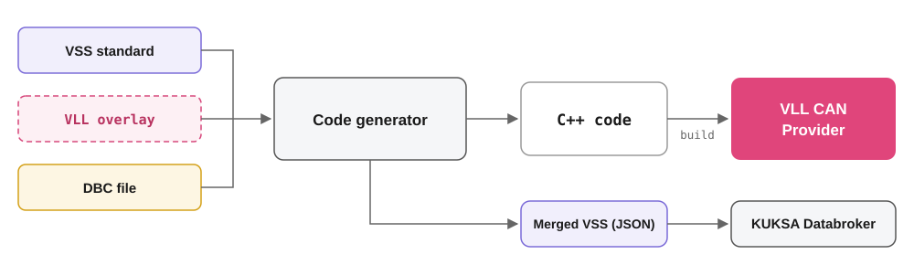
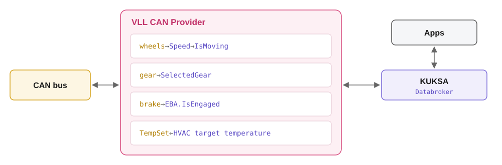

# VLL 컨셉 문서

> VLL 문법과 기능 상세는 [features.md](features.md)에서 다룬다. English: [../concept.md](../concept.md)

이 문서는 차량별 CAN 신호와 표준 VSS 신호 사이의 변환 규칙을 VSS overlay에 정의하는 언어 VLL(VSS Logic Language)과, 그 규칙으로 만드는 VLL CAN Provider의 개념을 설명한다.

## 1. 배경: 왜 VLL이 필요한가

### 1.1 VSS는 신호의 뜻만 정한다

VSS를 사용하면 앱은 차종과 관계없이 `Vehicle.Speed`와 같은 표준 이름으로 차량 데이터를 읽을 수 있다. 하지만 그 이름에 값을 채우는 방법은 VSS 밖의 일이며, provider가 맡는다. provider는 차량 신호를 읽어 KUKSA Databroker에 VSS 값을 전달하는 프로그램이다.

| VSS가 정하는 것 (WHAT) | 정하지 않는 것 (HOW) |
|---|---|
| 이름, 데이터 타입, 단위, 뜻 | 어떤 CAN 신호에서, 어떤 계산으로 값을 만드는가 |

변환 방법은 차종과 프로젝트에 따라 다르며, 일반적으로 provider마다 개별적으로 구현한다. 따라서 같은 VSS 신호를 만드는 규칙이 여러 곳에서 중복 구현된다. 표준 VSS는 여러 앱과 provider가 함께 쓰는 공통 정의이므로, 차종마다 다른 변환 내용을 표준 파일에 넣을 수도 없다. 대신 VSS는 표준 파일을 수정하지 않고 노드를 추가하거나 속성을 덧붙이는 overlay 파일을 지원한다.

### 1.2 실제 차량 신호는 1:1로 대응하지 않는다

실제 차량에서는 VSS 신호 하나를 만들기 위해 여러 CAN 신호를 조합하거나, 다른 VSS 신호를 참조하거나, 조건에 따라 다른 계산을 적용해야 하는 경우가 있다. 다음은 공개 데이터인 openDBC에 있는 사례다.

| 예 | 만드는 VSS 신호 | 계산 방법 |
|---|---|---|
| 현대: 속도 | `Vehicle.Speed` | 네 바퀴의 속도 신호를 평균한다 |
| Toyota: 이동 여부 | `Vehicle.IsMoving` | 바퀴 속도 4개의 평균으로 만든 `Vehicle.Speed`를 다시 입력으로 쓰며, 속도가 0이면 정지다 |
| GM: 변속 레버 | `Vehicle.Powertrain.Transmission.SelectedGear` | 두 CAN 신호의 조합에 따라 결과가 달라진다. 같은 값 4가 자동 모드에서는 D, 수동 모드에서는 10단이다 |
| Toyota: 긴급 제동 | `Vehicle.ADAS.EBA.IsEngaged` | 기능이 켜져 있고(상태 일치) 제동력이 음수일 때(값 크기 비교) 참이다 |

근거는 openDBC 커밋 [`48c7f06c`](https://github.com/commaai/opendbc/tree/48c7f06c6f27c41e7169242acb03ef9775658deb) 기준이다. openDBC 코드는 속도를 내부 변수(`vEgoRaw`)로 계산하는데, VLL에서는 이 값이 `Vehicle.Speed`에 해당한다.

- 현대 속도: [`car/hyundai/carstate.py` L89](https://github.com/commaai/opendbc/blob/48c7f06c6f27c41e7169242acb03ef9775658deb/opendbc/car/hyundai/carstate.py#L89) — `WHL_SPD11`의 바퀴 속도 4개를 [`parse_wheel_speeds()`](https://github.com/commaai/opendbc/blob/48c7f06c6f27c41e7169242acb03ef9775658deb/opendbc/car/interfaces.py#L287)로 평균한다
- Toyota 이동 여부: [`car/toyota/carstate.py` L82–L90](https://github.com/commaai/opendbc/blob/48c7f06c6f27c41e7169242acb03ef9775658deb/opendbc/car/toyota/carstate.py#L82-L90) — 바퀴 속도 4개의 평균(`vEgoRaw`)을 먼저 계산하고, 그 값으로 `standstill = abs(vEgoRaw) < 1e-3`을 판단한다
- GM 변속 레버: [`dbc/generator/gm/gm_global_a_powertrain.dbc` L310](https://github.com/commaai/opendbc/blob/48c7f06c6f27c41e7169242acb03ef9775658deb/opendbc/dbc/generator/gm/gm_global_a_powertrain.dbc#L310) — 신호 설명 `When ManualMode is Active, Value is 13=L1 ... 4=L10`
- Toyota 긴급 제동: [`car/toyota/carstate.py` L80](https://github.com/commaai/opendbc/blob/48c7f06c6f27c41e7169242acb03ef9775658deb/opendbc/car/toyota/carstate.py#L80) — `stockAeb = PRECOLLISION_ACTIVE and FORCE < -1e-5`

반대 방향의 변환도 마찬가지다. 운전석 목표 온도 `Vehicle.Cabin.HVAC.Station.Row1.Driver.Temperature`(°C)를 현대 DBC의 `TMU11.CF_Tmu_TempSet`(0~20 단계 값)으로 변환하려면, 온도 구간마다 다른 식이 필요하고 범위 밖의 값은 송신하지 않아야 한다.

| 목표 온도 T (°C) | `CF_Tmu_TempSet` |
|---|---|
| 16 ≤ T ≤ 17 | 0 |
| 17 < T < 27 | (T − 17) × 2 |
| 27 ≤ T ≤ 30 | 20 |
| 그 밖 | 송신하지 않음 |

위 변환 규칙은 설명을 위한 예시이며, 실제 차량의 신호 사양이 아니다.

### 1.3 변환 규칙을 코드에 직접 쓸 때의 문제

1.2절과 같은 변환 규칙은 일반적으로 provider 소스 코드에 C++나 Python 같은 범용 프로그래밍 언어로 직접 구현한다. openDBC도 차종마다 `carstate.py`라는 Python 코드에 구현한다. 이 방식에는 다음 문제가 있다.

- 변환 규칙이 provider 소스 코드에 포함된다. 차종이 바뀌면 소스 코드를 수정하고 다시 검증해야 하며, 규칙만 별도로 공유하거나 재사용하기 어렵다.
- 신호 사양은 입력 조합별 결과를 표로 제공하는 경우가 많다. 이를 조건문으로 옮기면 사양 담당자가 원래 표와 구현을 대조하기 어렵다.
- 잘못된 신호 이름이나 타입 불일치 같은 오류가 실행 단계에서야 발견될 수 있다.

## 2. 요구사항

1장의 배경에서 다음 요구사항을 도출했다.

### 2.1 표현해야 하는 것

| # | 요구사항 | 도출 배경 | 예 |
|---|---|---|---|
| R1 | 여러 CAN 신호를 함께 계산한다 | VSS 값 하나가 CAN 신호 여러 개에서 나온다(1.2 현대 속도) | 바퀴 속도 4개 → 속도 |
| R2 | 다른 VSS 신호를 입력으로 쓴다 | 이미 계산한 값을 다시 입력으로 쓴다(1.2 Toyota 이동 여부) | 속도 → 이동 여부 |
| R3 | 입력 값의 조합과 비교 조건으로 결과를 고른다 | 같은 CAN 값도 다른 신호에 따라 뜻이 바뀌고(1.2 GM 변속 레버), 상태와 값의 크기를 함께 본다(1.2 Toyota 긴급 제동) | 변속 레버, 긴급 제동 |
| R4 | actuator 목표값을 계산해 CAN으로 송신한다 | 반대 방향도 구간마다 다른 식이 필요하고, 범위 밖의 값은 송신하지 않아야 한다(1.2 온도 설정) | 목표 온도 → 온도 설정 단계 값 |

### 2.2 지켜야 하는 것

| # | 요구사항 | 도출 배경 |
|---|---|---|
| R5 | 변환 규칙은 provider 소스 코드가 아닌 VSS overlay 파일에 별도로 정의하며, 표준 VSS와 DBC는 수정하지 않는다 | 규칙이 소스 코드에 포함되면 차종마다 소스 코드를 수정해야 한다(1.3). 표준 VSS는 여러 곳이 함께 쓰는 공통 정의다(1.1) |
| R6 | 신호 사양을 검토하는 사람이 변환 규칙도 직접 검토할 수 있어야 한다 | 조건문으로 옮긴 코드는 사양 담당자가 원래 표와 대조하기 어렵다(1.3) |
| R7 | 규칙의 문법 오류, 신호 정의 오류, 타입 오류를 배포 전에 검출해야 한다 | 오류가 실행 단계에서야 발견될 수 있다(1.3) |

## 3. 개념

### 3.1 VLL과 입력

변환 규칙은 VLL로 정의한다. VLL은 차량 신호와 VSS 신호 사이의 변환 규칙을 정의하는 작은 전용 언어(DSL, Domain Specific Language)다. VSS가 정하지 않는 것, 즉 VSS 신호의 값을 계산하는 방법(HOW)을 정의한다(1.1절). 입력은 세 가지다.

| 입력 | 정의하는 것 | 이 프로젝트에서 |
|---|---|---|
| DBC 파일 | 차종별 CAN 메시지와 신호 | 그대로 쓴다 |
| 표준 VSS | 앱이 읽는 신호의 이름, 타입, 단위 | 그대로 쓴다 |
| VSS overlay 파일 | 표준 VSS에 덧붙이는 내용 | 변환 규칙을 여기에 정의한다 |

VLL 규칙은 빌드 단계에서 C++ 코드로 생성되어 VLL CAN Provider가 된다(5장).

### 3.2 규칙

VLL 규칙은 VSS 신호 하나에 연결되며, 입력 신호 목록과 그 VSS 값을 계산하는 로직으로 구성된다. 입력으로는 DBC에 정의된 CAN 신호(`<Message>.<Signal>`)와 다른 VSS 신호를 참조할 수 있다.

```yaml
Vehicle.Speed:
  vll:
    derive:
      inputs:
        - WHL_SPD11.WHL_SPD_FL: fl
        - WHL_SPD11.WHL_SPD_FR: fr
        - WHL_SPD11.WHL_SPD_RL: rl
        - WHL_SPD11.WHL_SPD_RR: rr
      logic: |
        this = (fl + fr + rl + rr) / 4
```

VLL 규칙은 표준 VSS 파일을 수정하지 않고 overlay 파일(`.vspec`)에 정의하며(1.1절), vss-tools로 표준 VSS와 병합한다. 표준 VSS와 DBC는 수정하지 않는다(R5).

### 3.3 두 방향: derive와 actuate

| 그룹 | 방향 | 쓰는 곳 |
|---|---|---|
| `derive` | CAN·VSS 신호 → 이 VSS 신호 | sensor, actuator의 현재값 |
| `actuate` | 이 VSS 신호 → CAN 신호 | actuator |

이 VSS 신호의 값을 다른 VSS 신호에 쓰려면 `actuate`가 아니라 그 신호의 `derive` `inputs`에 이 신호를 적는다(3.2절).

앱은 표준 VSS의 actuator 경로 하나로 목표값을 요청(Actuate)하고, VLL CAN Provider가 그 목표값을 받는다. 목표값을 위한 신호를 VLL에서 따로 정의하지 않는다.

다음은 1.2절의 온도 설정 사례를 VLL로 표현한 것이다. `actuate`는 이 VSS 신호가 갱신되면 로직을 실행하고, 출력 별명(`out1`)에 대입한 값을 CAN 신호로 송신한다. 일치하는 조건이 없으면 값을 만들지 않으므로, 범위를 벗어난 목표값은 CAN으로 송신되지 않는다.

```yaml
Vehicle.Cabin.HVAC.Station.Row1.Driver.Temperature:
  vll:
    derive:
      inputs:
        - DATC12.CR_Datc_DrTempDispC: temp
      logic: |
        this = temp
    actuate:
      outputs:
        - TMU11.CF_Tmu_TempSet: out1
      logic: |
        out1 = match (this) {
          (_) => {
            when (this >= 16.0 && this <= 17.0) => 0,
            when (this > 17.0 && this < 27.0) => (this - 17.0) * 2,
            when (this >= 27.0 && this <= 30.0) => 20
          }
        }
```

## 4. 왜 DSL인가

### 4.1 대안 비교

1.2절의 Toyota 긴급 제동 규칙을 openDBC의 구현 방식과 VLL로 각각 표현하면 다음과 같다.

openDBC — 차종별 Python 코드에 구현되어 있다([`car/toyota/carstate.py` L80](https://github.com/commaai/opendbc/blob/48c7f06c6f27c41e7169242acb03ef9775658deb/opendbc/car/toyota/carstate.py#L80)).

```python
ret.stockAeb = bool(cp_acc.vl["PRE_COLLISION"]["PRECOLLISION_ACTIVE"] and cp_acc.vl["PRE_COLLISION"]["FORCE"] < -1e-5)
```

VLL — VSS overlay 파일에서 VSS 신호에 연결된다.

```yaml
Vehicle.ADAS.EBA.IsEngaged:
  vll:
    derive:
      inputs:
        - PRE_COLLISION.PRECOLLISION_ACTIVE: active
        - PRE_COLLISION.FORCE: force
      logic: |
        this = active && force < -0.00001
```

openDBC에서는 변환 규칙이 차종별 Python 코드에 직접 구현되며, 결과도 openDBC `CarState`의 필드(`stockAeb`)에 담긴다. VLL에서는 변환 규칙을 표준 VSS 신호에 연결해 overlay 파일에 정의한다. 차종이 바뀌면 해당 차종의 DBC와 overlay를 사용한다. 변환 규칙은 overlay에서 관리하며, 바뀐 규칙으로 C++ 코드를 다시 생성하고 VLL CAN Provider를 빌드한다. 같은 규칙을 상태와 값의 크기로 나눠 적는 `match` 형태는 [features.md](features.md) 6.2절에 있다.

규칙을 적는 방법은 다음과 같이 비교했다.

| 방법 | 문제 |
|---|---|
| C++나 Python 같은 범용 언어로 규칙 작성 | 표현 범위가 넓고 구현 세부 사항이 함께 들어가므로, 변환 규칙만 분리해 읽고 검토하기 어렵다 |
| **작은 전용 언어(DSL)** | 요구사항 R1~R4에 필요한 표현 위주로 제공한다. SQL이나 정규식처럼 특정 목적에 맞게 설계된 언어다 |

### 4.2 설계 원칙

**익숙한 문법을 쓴다.** `match` 문법은 Rust의 `match`를 참고했다. Rust의 `match`는 값을 여러 패턴과 비교해, 일치하는 패턴에 따라 결과를 고르는 구문이다.

```rust
// Rust
let gear = match (manual, prndl) {
    (0, 1) => 126,
    (1, _) => 14 - prndl,
    _      => 0,
};
```

```text
// VLL
this = match (manual, prndl) {
    (0, 1) => 126,
    (1, _) => 14 - prndl,
    (_, _) => 0
}
```

**결정 테이블과 코드가 줄 단위로 대응한다(R6).** 신호 사양은 입력 값의 조합별로 결과를 적은 결정 테이블(decision table)로 주어지는 경우가 많다. `match`의 한 줄이 그 표의 한 행이다. 이런 표를 if/else 조건문으로 옮기면 행 누락이나 조건 순서 변경으로 사양과 구현이 달라지기 쉽다. VLL은 표의 각 행을 `match`의 한 줄로 표현하므로, 사양과 구현을 줄 단위로 대조할 수 있다.

| manual | prndl | SelectedGear | VLL |
|---|---|---|---|
| 0 | 1 | 126 (P) | `(0, 1) => 126,` |
| 0 | 2 | -1 (R) | `(0, 2) => -1,` |
| 0 | 3 | 0 (N) | `(0, 3) => 0,` |
| 0 | 4 | 127 (D) | `(0, 4) => 127,` |
| 1 | 아무 값 | 14 − prndl | `(1, _) => 14 - prndl,` |
| 그 밖 | | 0 | `(_, _) => 0` |

값은 VSS `SelectedGear` 정의를 따른다(0=Neutral, 양수=전진 단, 음수=후진, 126=Park, 127=Drive). 설명을 위한 예시라 자동 모드의 일부 값(L 등)은 적지 않았다.

**실행 시점에 해석하지 않고 빌드 단계에서 C++ 코드로 생성한다(R7).** VLL 규칙을 C++ 코드로 생성한 뒤 컴파일해 VLL CAN Provider에 포함한다. 이 과정에서 문법 오류, 없는 신호 주소, string과 숫자를 섞는 것 같은 타입 오류를 배포 전에 검출한다(5.1절).

## 5. VLL CAN Provider 구성

### 5.1 빌드



- VLL 규칙을 C++ 코드로 생성하고 컴파일해 VLL CAN Provider를 빌드한다. 규칙 오류(문법 오류, 없는 신호 주소, string과 숫자를 섞는 것 같은 타입 오류)는 이 단계에서 검출된다.
- 같은 단계에서 표준 VSS와 overlay를 병합한 VSS 파일(JSON)도 만든다. overlay에서 바꾼 타입과 추가한 신호가 들어 있으므로, KUKSA Databroker는 표준 VSS가 아니라 이 파일로 실행한다.
- 대상 장치에는 VLL CAN Provider와 병합된 VSS 파일을 배포한다. DBC와 overlay 원본은 런타임에 필요하지 않다.

### 5.2 런타임



VLL CAN Provider 안의 각 줄이 VLL 규칙 하나다.

- VLL CAN Provider는 KUKSA Databroker 밖에서 동작하며 kuksa.val.v2 API(gRPC)로 연결한다. Databroker를 대체하거나 수정하지 않는다.
- 앱은 표준 VSS 신호만 읽는다. 어느 차의 어느 신호를 어떤 식으로 계산했는지는 VLL CAN Provider가 맡고, 차종이 바뀌면 앱이 아니라 overlay만 바뀐다.
- VLL CAN Provider는 CAN 신호를 수신해 VSS 값을 계산하고 Databroker에 전달한다. 반대 방향으로는 Databroker에서 actuator 목표값을 수신해 CAN 신호로 변환하고 송신한다.
- CAN 프레임은 DBC에 정의된 scale과 offset을 적용해 물리값으로 디코딩한 뒤 VLL 규칙의 입력으로 전달한다. VLL 규칙에서 scale/offset을 다시 계산하지 않는다.
- 입력 신호가 바뀌면 그 신호를 쓰는 규칙을 다시 계산하고, `actuate` 결과가 바뀌면 CAN으로 송신한다. 주기 송신은 하지 않는다.
- 다른 VSS 신호를 입력으로 쓰는 규칙은 그 입력 신호가 먼저 계산된 뒤 계산된다(예: 바퀴 속도 → `Vehicle.Speed` → `Vehicle.IsMoving`).
- 빌드 단계에서는 VLL 규칙의 문법, 참조하는 신호의 존재, string과 숫자를 섞는 것 같은 타입 오류만 검증한다. actuator 출력값이 차량 동작상 안전한지는 검증하지 않으며, VLL 검증이 차량의 기능 안전 검증을 대체하지 않는다.
